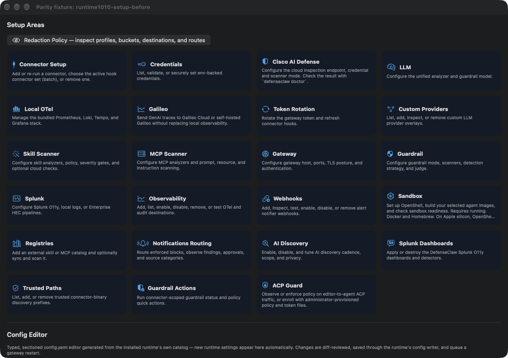
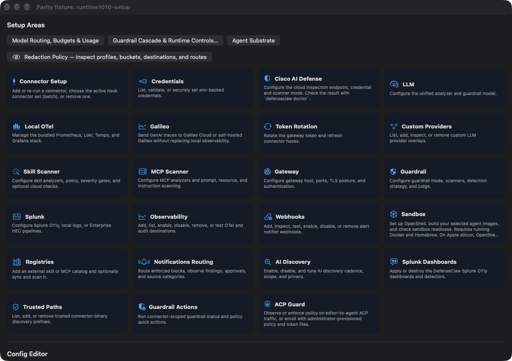

# Runtime 1.0.10 feature coverage — 2026-11-24

The Mac app now exposes the operator-facing additions in [DefenseClaw 1.0.10](https://github.com/cisco-ai-defense/defenseclaw/releases/tag/1.0.10). This is a feature-access and local contract verification, **not certification of every live integration**. Cloud decision services, fleet budgets, an enrolled managed account, and a Kubernetes cluster were not exercised.

## Targets and isolation

- App checkout: `defenseclawmac-release-1.1.35`, branch `kobrien/runtime-1.0.10-features`, based on main `299598ca2a7bbaa00d7654b0ef763fdf4f965718` (merged upgrade fix, PR #42). App metadata is 1.1.37, build 1, bundle `com.keitheobrien.DefenseClawMac`.
- Selected release source: tag `1.0.10`, commit `a64bfdb9319a41173da3da34e4e2f9c8ea6a2267`. Comparison release: 1.0.9, `c4183a400c4dd04ffdb4ab78634b8a7a3371dbbb`.
- Upstream main observed on November 24: `baaefcd4ea6c970978b2908b5bd31e42e158841e`. This report targets the release, not all changes subsequently added to main.
- Installed executable: `/Users/kobrien/.local/bin/defenseclaw`; interpreter: `/Users/kobrien/.defenseclaw/.venv/bin/python`; installed distribution: **1.0.10**, configuration schema 9. The release source's Python metadata still says 1.0.0; installed distribution requirements and executable contracts were checked separately.
- Real-runtime writes used a temporary home/configuration and a reserved, non-listening loopback port. No live configuration, gateway, connectors, model credentials, or enforcement settings were changed.
- Native tests built a separate `DefenseClawMacParityTest` app with synthetic CLI/API data. They do not validate the installed production app or live services. The canonical checkout's unrelated changes were preserved.

## Feature matrix

**PASS** means only the stated test passed. **SOURCE REVIEW** means the integration path was inspected without exercising its external behavior. **NOT TESTED** identifies remaining integration checks.

| 1.0.10 addition | Mac app access | Evidence and limits |
|---|---|---|
| Model routing setup, classifiers, models and defaults | New **Model Routing** sidebar panel; setup/add/default/remove forms and command palette | **PASS:** native status and model Review → Apply; real-runtime add/default writes. Classifier-specific advanced settings include categories, sensitivity, System One and remote routing. **NOT TESTED:** live model dispatch or classifier endpoints. |
| Routing rules and profile overlays | Add, move, remove forms; effective rules display; advanced administrator policy | **PASS:** real-runtime rule add/move/remove; argument separation and selector validation. **SOURCE REVIEW:** profile overlay flags. **NOT TESTED:** live profile/identity evaluation. |
| User/group/connector budgets and fleet store | Budget forms and effective usage display; `routing.admin` settings | **PASS:** real-runtime budget add/remove; limits and unknown spend display. **NOT TESTED:** enforcement, fleet synchronization, group membership. |
| Claude Code/Codex route-only mode | Enable/disable routing form with connector selector, plus palette commands | **SOURCE REVIEW:** supported 1.0.10 CLI flags; native review uses the same guarded command path. **NOT TESTED:** rewriting real agent settings or routing their traffic. |
| Conversation context | Native **Conversation context** form and advanced `routing.context` | **PASS:** actual Swift-generated configuration saved by the real runtime; bounds/JSON tests and native form render. Reads current state before replacement; records no tool arguments/results. **NOT TESTED:** live routing decisions using history. |
| Routing status, health, recent decisions, test/explain | Status panel, effective-state disclosure and actions | **PASS:** native status, managed, command failure, malformed JSON, unknown-cost and older-runtime states. Bounded polling for unapplied changes is source-reviewed; no endless refresh. **NOT TESTED:** a real gateway applying a routing change. |
| Tokenomics/local usage and retention | Usage tab; status/enable/disable actions; advanced tokenomics settings | **PASS:** real-runtime enable/disable, including `local_store.enabled`; native usage with missing price. **NOT TESTED:** real streaming token capture and judge/AI Defense billing records. |
| Pricing tables | Prices tab; set/import forms; advanced pricing | **PASS:** real-runtime price set, native display, finite/nonnegative validation. **SOURCE REVIEW:** import command. Unknown cost stays unknown. **NOT TESTED:** current vendor prices or imported production tables. |
| Guardrail cascade, connector/profile overrides, admin locks | Setup → **Guardrail Cascade & Runtime Controls** → explain/advanced settings | **PASS:** scoped key construction, real-runtime config writer and stale/invalid-write rejection. Runtime remains the validator and policy authority. **NOT TESTED:** live cascade enforcement or a managed lock rejection. |
| Alignment lane (`off`, `shadow`, `alert`, `block`) | Native **Alignment checks** form with profile/connector scope | **PASS:** native form; real-runtime alignment write. **NOT TESTED:** judge-produced `ALIGNMENT-DRIFT` or blocking a tool call. |
| Gemini Decisions protocol | Runtime-generated Config Editor → Decision Model; advanced `decision_model.protocol` | **PASS:** protocol persisted by the actual 1.0.10 validator. **SOURCE REVIEW:** dynamic runtime catalog includes the protocol selector. **NOT TESTED:** Google Decisions API calls. |
| Secret-flow policy and improved command parsing | Advanced secret-flow settings; existing guardrail/alerts/audit surfaces | **SOURCE REVIEW:** settings flow through runtime validation; parsing, findings and policy semantics stay in the runtime. **NOT TESTED:** this release's complete security regression corpus. |
| OpenClaw native/hybrid hooks, prompt gate and install policy | Runtime Controls preflight; advanced `connectors.openclaw` | **PASS:** real-runtime hooks/prompt-gate/install-policy configuration write. **SOURCE REVIEW:** gateway preflight command. **NOT TESTED:** actual OpenClaw hook installation or execution. |
| OpenClaw external plugin/separate user layout | Advanced `connectors.openclaw`, `claw.home_dir`, `claw.config_file`; existing connector setup | **SOURCE REVIEW:** public config schema and existing presence/path handling. **NOT TESTED:** external-plugin installation or separate-user permissions. |
| OpenClaw scoped credentials and gateway-token migration | Existing runtime migration/setup and protected gateway connection | **PASS:** existing config-editor/token-ladder safety tests. **SOURCE REVIEW:** Mac token resolution refuses the OpenClaw credential as a DefenseClaw gateway credential. **NOT TESTED:** migration of a real account during this feature check. |
| Agent Substrate launcher and visibility | New **Agent Substrate** panel; list/doctor/usage/approvals; reviewed commands for Terminal sign-in/run/connect/pull | **PASS:** synthetic agent view and terminal-only classification. Copied commands retain the selected executable/home/config. **NOT TESTED:** authentication, real actors, approvals or pulling changes. |
| Agent Substrate Kubernetes deployment | Advanced `substrate` configuration; runtime Helm deployment remains external | **SOURCE REVIEW:** supported configuration and launcher contract. The Mac app does not install Kubernetes or deploy a chart. **NOT TESTED:** cluster deployment, proxy enforcement, egress or per-actor limits. |
| ACP refresh and Cowork setup | Runtime Controls; Cowork also in updated palette | **SOURCE REVIEW:** `acp refresh --agent`; Cowork builds its ZIP without opening/waiting for Claude. Account plugin upload remains manual. **NOT TESTED:** refreshing a live agent or installing a Cowork account plugin. |
| Complete local/remote MCP inventory export | Existing Inventory and runtime observability setup | **SOURCE REVIEW:** runtime produces the richer MCP inventory/export; the Mac inventory detail preserves all returned fields. Existing inventory/parser/capability suites pass. No separate file-export feature is claimed. **NOT TESTED:** live remote MCP discovery or telemetry delivery. |
| Telemetry registry v4 and routing/cost dashboards | Existing Local OTel, Splunk Dashboards and Observability setup; new usage/pricing controls | **SOURCE REVIEW:** app invokes runtime-provided setup and reads runtime-generated catalog/status. **NOT TESTED:** rendering the new Grafana/Splunk boards with live events. |
| Kiro dual hooks, Copilot rewrite reporting, Hermes scan efficiency, newer sandbox Claude | Existing connector, discovery, sandbox, status and audit UI | **SOURCE REVIEW:** these are runtime implementations; they do not need duplicate Mac logic. Existing connector/runtime/sandbox suites pass. **NOT TESTED:** live clients for each connector. |
| Hook concurrency, parser/security fixes, managed installers | Existing runtime upgrade, doctor/status, gateway and sandbox surfaces | **SOURCE REVIEW:** supplied by runtime binaries. The preceding PR #42 handles OpenCode's persistent service during upgrades. Windows/Linux installer fixes are not Mac UI features. **NOT TESTED:** load, managed deployment or installer recovery. |

## Changes and safety

- Added native routing/usage/prices and Substrate panels, Setup entry points, structured forms and advanced validated settings.
- Synced the command palette from the **pinned 1.0.10** registry: **281 commands**, previously 249. New routing/Substrate/Cowork entries require runtime 1.0.10. Interactive Substrate commands are copied for Terminal rather than launched without a terminal.
- Writes use the selected runtime and existing Activity/mutation controls. Native forms require Review → Apply. New advanced configuration values travel through hidden stdin to the runtime's own CLI, never OS arguments or Activity output.
- Configuration reads are masked by the runtime. Saves require a matching configuration hash and are refused after external edits. Changing the selected installation invalidates a form and stale results. Reads reject truncated/malformed JSON; failed/unknown scope does not enable routing mutations.
- No credentials are accepted in the model form: it takes environment variable **names**. Existing credential setup handles values. Advanced settings warn against saving masked read-back values as credentials.

## Verification results

| Check | Result |
|---|---|
| Standalone `script/test_*.sh` suites | **47 PASS, 1 SKIP** after targeted reruns. Policy catalog and sandbox tests initially selected a different source runtime; both passed when explicitly pinned to 1.0.10. The new feature suite was also rerun after editing ended. |
| New feature pure-logic tests | **PASS:** separate arguments, repeated flags, secrets-as-env-names, prices, scoped keys, JSON, context bounds, version gates, terminal-only commands, partial rows and unknown/zero cost. |
| Real 1.0.10 CLI round trips | **PASS:** model/default, rules, budgets, price, alignment, Gemini protocol, OpenClaw settings, conversation context, tokenomics; invalid/stale config unchanged. |
| Fresh production Debug compile | **PASS:** ad-hoc compile in temporary DerivedData. No Swift build warnings; Xcode emitted its routine missing-AppIntents metadata warning. |
| Native GUI fixture | **PASS:** routing, usage, prices, Substrate, controls, context, alignment, Setup, older-runtime gate, model review/apply and Activity; managed/failure/malformed states rendered and inspected. |
| Source/registry/schema/dependency audit | **PASS:** 281 registry entries, config v9, runtime help, flat packaging and installed package requirements. Source package version differs from wheel metadata, as noted above. |
| Historical standalone source-hash baseline | **FAIL (baseline drift):** still pins upstream `00ef714b8a47f3ba90dad69b91dc8aa40c735057` and older standalone hashes. It was not rewritten to make this report green. Current-release command/config contracts were reviewed separately; a full recertification of every historical standalone divergence remains outstanding. |
| Sandbox inspector opt-in native layout suite | **SKIP** in the shell suite; unrelated to the new routing fixture. |
| Live cloud/managed/Kubernetes integrations | **NOT TESTED**, as detailed per feature above. |
| Notarized release | **BLOCKED** by the previously identified missing Apple notarization profile. No unnotarized artifact was published. |

Commands used (paths can be adjusted to the local checkout):

```bash
./script/test_runtime_1010_features.sh
RUNTIME_1010_TEST_PLAN=/private/tmp/DefenseClawMac-runtime1010-plan.json ./script/test_runtime_1010_features.sh
/Users/kobrien/.defenseclaw/.venv/bin/python Tests/Runtime1010RoundTripTests.py \
  /Users/kobrien/.defenseclaw/.venv/bin/python /private/tmp/DefenseClawMac-runtime1010-plan.json
DEFENSECLAW_RUNTIME_PYTHON=/Users/kobrien/.defenseclaw/.venv/bin/python ./script/test_policy_catalog.sh
DEFENSECLAW_UPSTREAM_ROOT=/private/tmp/defenseclaw-1.1.37-upstream ./script/test_sandbox_models.sh
python3 script/test_panel_native_smoke.py --run-runtime1010-gui
xcodebuild -project DefenseClawMac.xcodeproj -scheme DefenseClawMac \
  -configuration Debug -destination 'generic/platform=macOS' \
  -derivedDataPath /private/tmp/DefenseClawMac-runtime1010-build \
  CODE_SIGN_STYLE=Manual CODE_SIGN_IDENTITY=- DEVELOPMENT_TEAM= build
git diff --check
```

## Visual evidence

All screenshots use synthetic fixture data. The before image is built from main commit `299598c`; the after images use this feature branch. The older-runtime gate is a separate test, not the before image.

| Setup before | Setup after |
|---|---|
|  |  |

[Routing](../images/runtime-1.0.10/routing.png) · [Usage](../images/runtime-1.0.10/usage.png) · [Prices](../images/runtime-1.0.10/prices.png) · [Conversation context](../images/runtime-1.0.10/context.png) · [Alignment](../images/runtime-1.0.10/alignment.png) · [Substrate](../images/runtime-1.0.10/substrate.png) · [Review](../images/runtime-1.0.10/review-model.png) · [Managed](../images/runtime-1.0.10/routing-managed.png) · [Command failure](../images/runtime-1.0.10/routing-fail.png) · [Malformed data](../images/runtime-1.0.10/routing-malformed.png)

## Runtime limitations retained

The Mac app does not repair 1.0.10's reported interrupted-stream budget undercount, lingering budget sync, some managed Active Directory users' empty routing view, or unavailable macOS MicroVM sandboxes. Default prices are not verified vendor prices. The new UI calls out budget and price limitations; use the runtime release notes for fixes and migration guidance. Live acceptance should cover the selected cloud classifier, Claude/Codex route-only traffic, a managed user's scoped view and budgets, OpenClaw hooks, telemetry dashboards, and a real Substrate cluster before claiming end-to-end parity.
