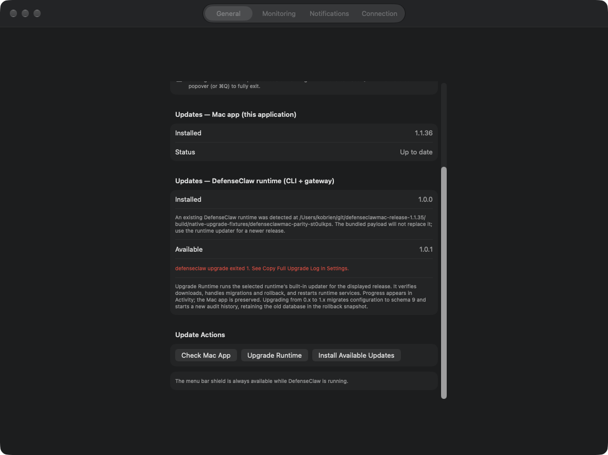
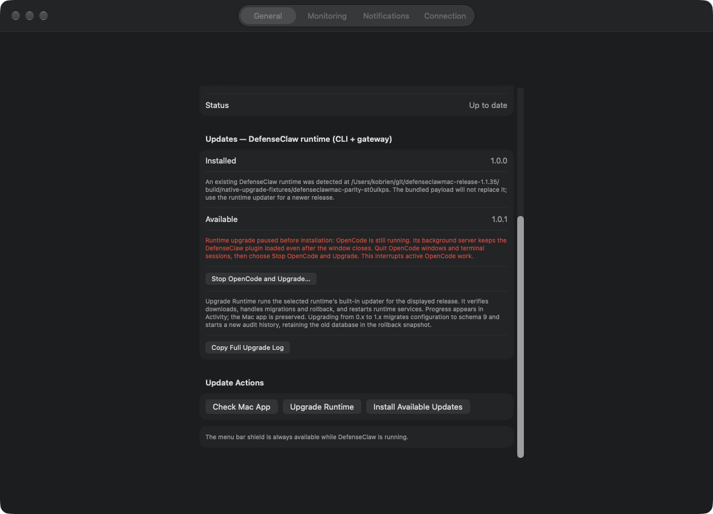
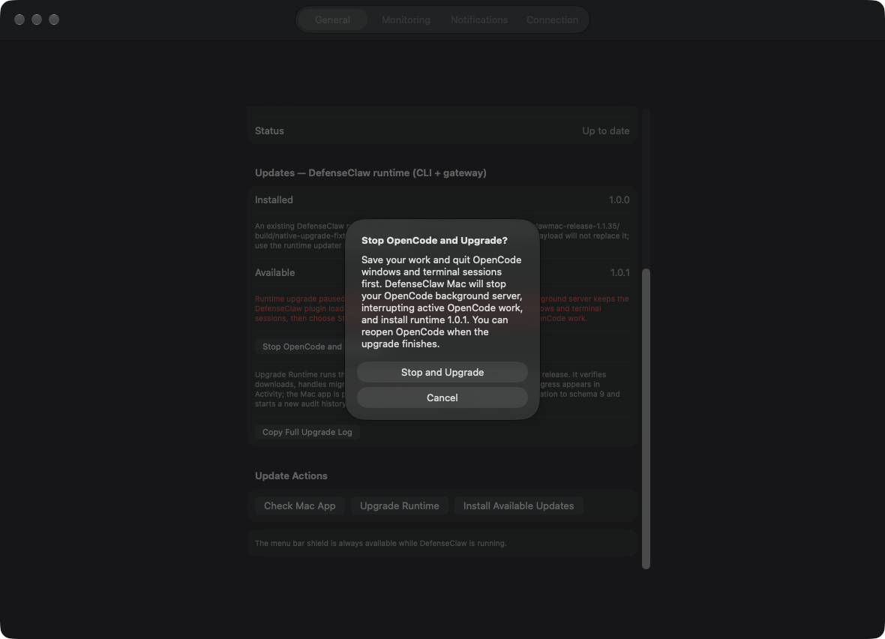

# OpenCode runtime upgrade preparation

OpenCode V2 keeps a background server and its loaded DefenseClaw plugin after its window closes. The DefenseClaw 1.0.10 release installer rejects runtime replacement while OpenCode or Amp still holds the old plugin. DefenseClawMac previously reached that check only after downloading and staging the release, then summarized the installer's `✗` failure as a generic exit code.

The app now checks for recognized native OpenCode and Amp processes before downloads, administrator gateway stop, ownership repair, or runtime replacement. Only this account's processes whose kernel executable path matches an installed launcher are recognized. Paths are canonicalized consistently across macOS aliases. Interpreted wrappers and processes started after this check remain covered by the release installer's final guard; its original error is now visible in Settings and the update banner.

When only OpenCode remains, Settings and the banner offer **Stop OpenCode and Upgrade…**. The confirmation explains that active OpenCode work will be interrupted and asks the operator to close windows and terminal sessions first. Consent is bound to the selected installation, CLI, and release, including an already-confirmed source-to-release switch. After confirming, the app verifies OpenCode V2, runs that executable's `service stop` without elevation, and checks that no recognized agent remains before installing. A foreground session, respawned server, failed command, unreadable process scan, changed selection, or cancellation prevents installation. Service commands have bounded timeouts. The stop and upgrade share one cancellable Activity operation and the existing runtime exclusivity guard.

The app does not restart OpenCode after installation. Reopen it after the upgrade so it loads the updated plugin. Amp and older OpenCode versions must be closed manually. The runtime/TUI installer and its shutdown requirement are unchanged.

## Verification

Contract inspected: DefenseClaw runtime **1.0.10**, `scripts/install.sh` / `assert_no_loaded_plugin_agents`. Installed OpenCode reports **opencode v2.3.2**. Native UI tests use a disposable runtime (1.0.0 → 1.0.1), fake V2 service, and synthetic data; they do not reinstall or downgrade the live runtime.

```sh
./script/test_runtime_upgrade_agents.sh
./script/test_cli_cancellation.sh
./script/test_gateway_administrator.sh
./script/test_runtime_ui_compatibility.sh
python3 script/test_panel_native_smoke.py --run-upgrade-gui
# Focused native UI rerun:
python3 script/test_panel_native_smoke.py --run-opencode-upgrade-gui
xcodebuild -project DefenseClawMac.xcodeproj -scheme DefenseClawMac \
  -configuration Debug -destination 'generic/platform=macOS' \
  CODE_SIGN_STYLE=Manual CODE_SIGN_IDENTITY=- DEVELOPMENT_TEAM= build
git diff --check
```

The focused suite covers native process detection, account/path isolation, V2 version validation, the reported installer error, missing consent, successful stop, Amp, V1, version/stop failure, respawn, cancellation, process-scan failure, and installation reselection. Existing gateway recovery and command-cancellation tests remain in place. The native fixture exercises the recovery screen, the real confirmation dialog and Cancel action, stale-release consent, Activity output, and a successful confirmed retry.

## Screenshots

All screenshots use synthetic data. The before image reproduces the previous generic error in the native Settings view.






